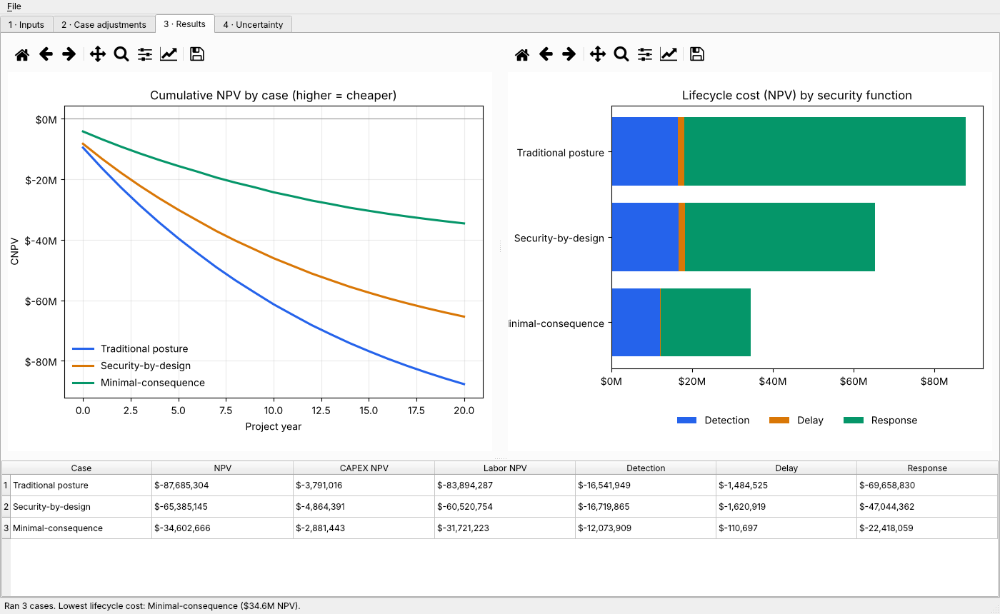
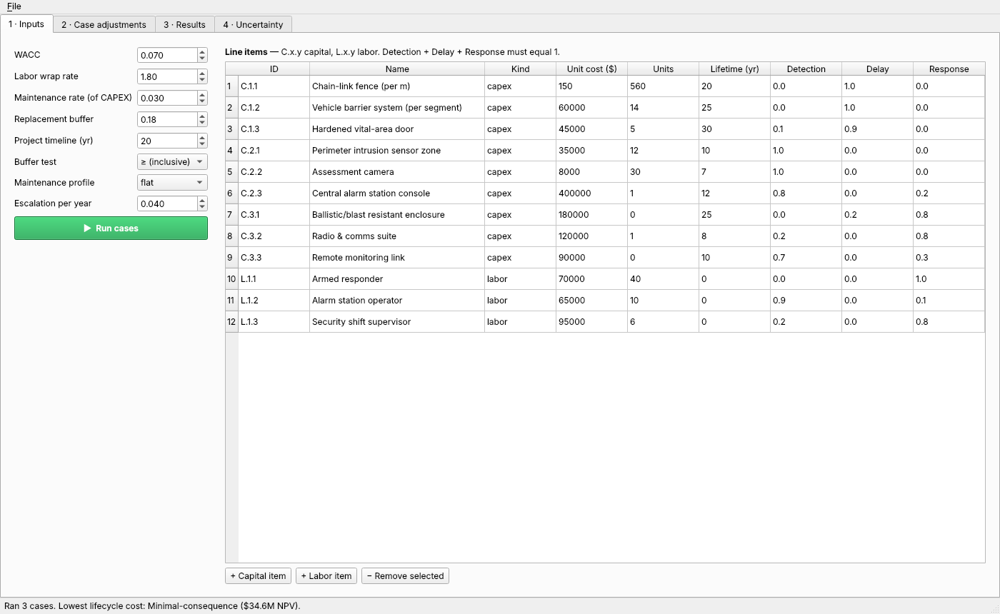
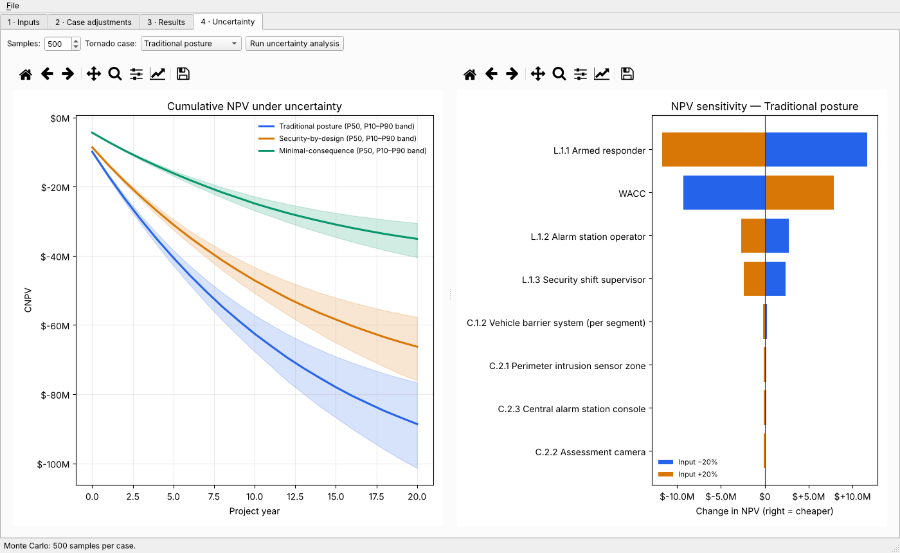

# Security Posture Lifecycle Cost Tool

A Python + PyQt6 desktop tool for comparing the **lifecycle cost of physical-security postures** (for example at an advanced or micro nuclear reactor) under uncertainty.

It models capital assets and security staffing over a project timeline, computes **NPV and cumulative NPV (CNPV)** for up to 10 cases, attributes cost to **detection, delay and response**, and adds **Monte Carlo uncertainty bands** and a **sensitivity (tornado) analysis**. Spreadsheet cost models are usually deterministic and lack these two analyses.



## Why

Advanced reactor developers need to show that a security posture is effective *and* affordable. Moving from a traditional staffing-heavy posture to a **security-by-design** posture shifts spending from labor (OPEX) to engineered features (CAPEX). This tool makes that trade-off visible across a 20-year life, and shows how confident you can be in the ranking once costs, lifetimes and the discount rate are uncertain.

## Features

| Area | What it does |
|---|---|
| Cost engine | Year-0 purchase, lifetime-based replacement, maintenance as % of CAPEX, labor × wrap rate, discounting at WACC |
| Replacement buffer | Skips repurchasing an asset near project end when `(T − year) ≥ lifetime × buffer`; inclusive (≥) or strict (>) test is selectable |
| Case adjustments | Per case and per item: Δunits, ×cost, Δmaintenance, Δlifetime, WACC override |
| Maintenance profiles | Flat, escalating with asset age, or **bathtub curve** (early-life and wear-out failures) |
| Attribution | NPV split into detection / delay / response; validated to sum to 1 per item |
| Uncertainty | Monte Carlo over WACC, CAPEX overrun (triangular), labor rates, maintenance rate, asset lifetimes → P10/P50/P90 CNPV bands |
| Sensitivity | ±20 % tornado chart of the biggest NPV drivers |
| I/O | Scenario JSON load/save; **Excel export** (summary, CNPV with native chart, per-case timelines); CSV |
| Interfaces | PyQt6 GUI with embedded matplotlib charts, plus a headless command-line runner |
| Quality | 14 pytest tests, including the documented replacement-buffer worked examples; GitHub Actions CI |

📘 **[User guide](docs/USER_GUIDE.md)**: every field, chart and calculation explained · 🎬 **[Demo guide](docs/DEMO_GUIDE.md)**: step-by-step walkthrough

## Quick start

```bash
git clone https://github.com/<your-username>/secposture.git
cd secposture
python -m venv .venv && source .venv/bin/activate     # Windows: .venv\Scripts\activate
pip install -r requirements.txt

python -m secposture.gui                 # desktop app
python -m secposture.cli --out results   # headless: charts + results.xlsx
pytest -q                                # tests
```

## Model

For line item *i* in case *c*, year *y* ∈ {0..T}:

```
units   = baseline_units + Δunits[c,i]
cost    = unit_cost × cost_mult[c,i]
CAPEX   = cost × units

capital item:
  y = 0                                        → CAPEX
  y % lifetime = 0  and  (T − y) ≥ L × buffer   → CAPEX                 (replacement)
  otherwise                                    → CAPEX × (m + Δm) × f(age)   (maintenance)
labor item:
  every year                                   → cost × units × wrap_rate

NPV  = − Σ_y Σ_i cost[i,y] / (1 + WACC)^y
CNPV = running sum (negative: all values are expenditures; higher line = cheaper)
```

`f(age)` is 1 for flat maintenance, `(1+g)^(age−1)` for escalating, and a U-shaped curve for bathtub.

### Edge cases the tests pin down
* A 9-year asset in a 20-year project is replaced at years 9 and 18 with an 18 % buffer, but only at year 9 with a 25 % buffer.
* When the remaining time exactly equals `lifetime × buffer`, the inclusive and strict rules give different answers, so the rule is configurable.
* With a zero buffer and the inclusive rule, an asset can be "replaced" in the final project year and never used. A small positive buffer prevents this.

## Screenshots

| Inputs | Uncertainty |
|---|---|
|  |  |

## Example data

The built-in scenario (`examples/example_scenario.json`) uses **illustrative placeholder costs and staffing levels**, not real facility data. It compares a traditional posture, a security-by-design posture (fewer responders, added ballistic enclosures) and a minimal-consequence facility. With these assumptions, labor dominates lifecycle cost. That is why the security-by-design and minimal-consequence cases come out far cheaper, and why responder headcount and WACC lead the tornado chart.

## Project layout

```
secposture/
  engine.py       cost model (pure Python + NumPy, no GUI)
  uncertainty.py  Monte Carlo + tornado
  reporting.py    matplotlib charts, Excel/CSV export
  scenarios.py    JSON I/O and the example scenario
  gui.py          PyQt6 application
  cli.py          headless runner
tests/            pytest suite
examples/         example scenario JSON
docs/             screenshots and charts
```

## Roadmap
- Financing schedules (loans/leases) per asset
- Cost-vs-effectiveness: pair each case with an adversary-path model (e.g. EASI) to plot NPV against probability of interruption
- Climate-driven maintenance (freeze–thaw cycles, snow load, nuisance-alarm rates)
- Import of existing spreadsheet case sheets via openpyxl

## Author
Kannika Armstrong, M.S. Computer Science (UW Tacoma, Dec 2026)

License: MIT
