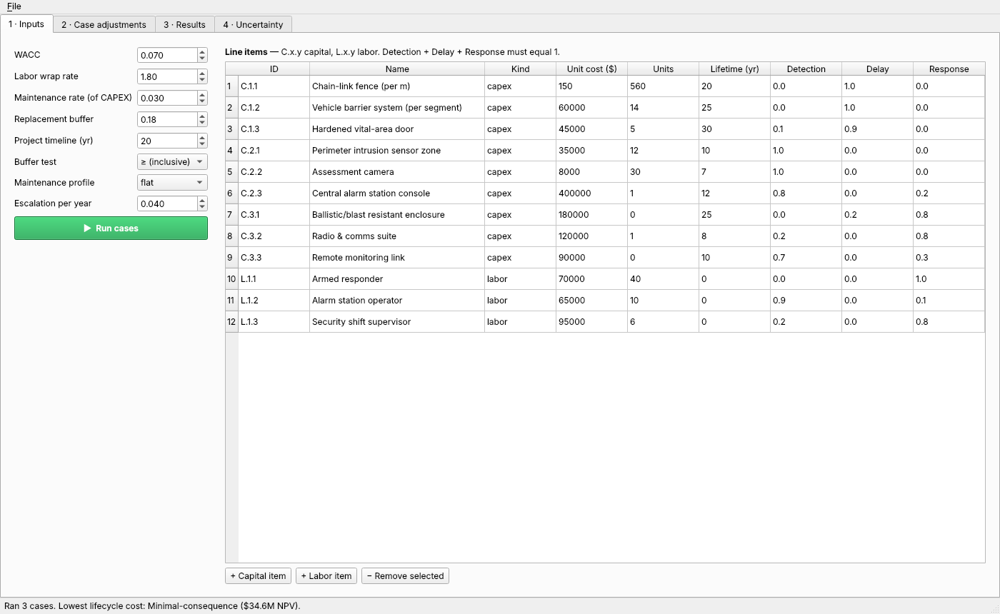
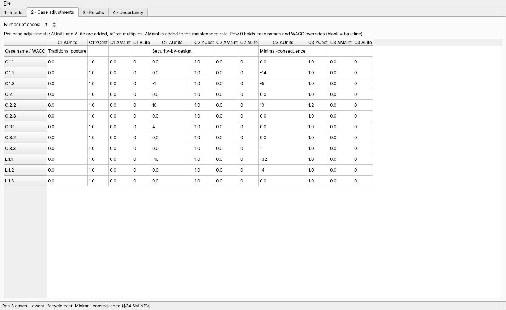
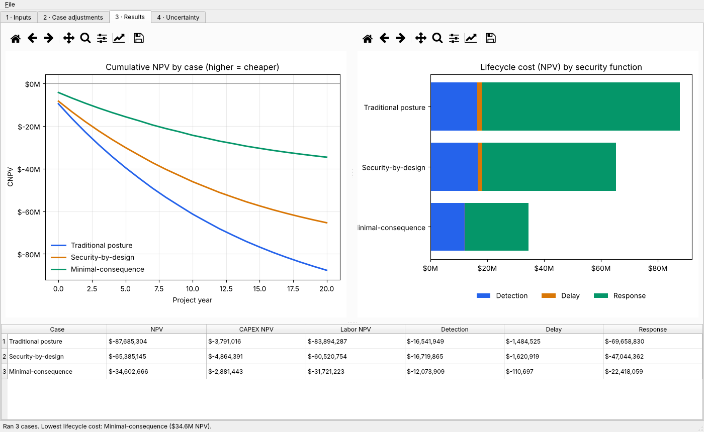
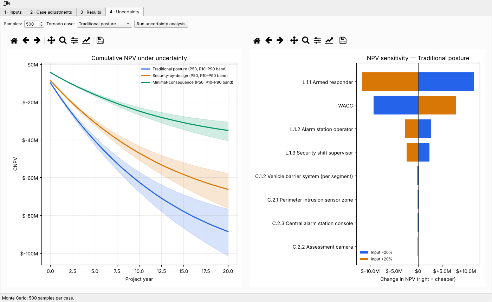

# Security Posture Lifecycle Cost Tool: User Guide

Version 0.1.0 · Author: Kannika Armstrong

---

## Contents

1. [What the tool does](#1-what-the-tool-does)
2. [Installation](#2-installation)
3. [Starting the tool](#3-starting-the-tool)
4. [Key concepts](#4-key-concepts)
5. [Tab 1: Inputs](#5-tab-1--inputs)
6. [Tab 2: Case adjustments](#6-tab-2--case-adjustments)
7. [Tab 3: Results](#7-tab-3--results)
8. [Tab 4: Uncertainty](#8-tab-4--uncertainty)
9. [File menu: saving, opening and exporting](#9-file-menu--saving-opening-and-exporting)
10. [Walkthrough: building your own comparison](#10-walkthrough--building-your-own-comparison)
11. [How the calculation works](#11-how-the-calculation-works)
12. [Command-line use](#12-command-line-use)
13. [Scenario file format (JSON)](#13-scenario-file-format-json)
14. [Troubleshooting](#14-troubleshooting)
15. [Assumptions and limitations](#15-assumptions-and-limitations)
16. [Glossary](#16-glossary)

---

## 1. What the tool does

The tool compares the **total lifetime cost of different physical-security designs** (called *cases* or *postures*) for one facility, such as a microreactor site.

For each case it:

- adds up what you spend every year on **equipment** (fences, sensors, cameras, doors, consoles) and **staff** (responders, alarm operators, supervisors);
- replaces equipment when it wears out, and charges **maintenance** in the years between;
- converts each future year's spending into **today's dollars** (net present value, NPV), so cases with different spending patterns can be compared fairly;
- splits the cost into the three security functions: **detection, delay and response**;
- shows how **certain** the comparison is when costs, lifetimes and the discount rate are uncertain (Monte Carlo), and **which inputs matter most** (tornado chart).

Typical question it answers: *"If we design security into the facility (more hardened features, fewer guards), how much do we save over 20 years, and how sure are we?"*

> **Note:** The built-in example uses **illustrative placeholder numbers**, not real facility data. Replace them with your own figures before drawing conclusions.

---

## 2. Installation

**Requirements:** Python 3.10 or newer, on Windows, macOS or Linux.

Recommended: keep the project **outside OneDrive** (for example `C:\dev\secposture`) and give it its **own virtual environment**.

```bat
cd C:\dev\secposture
python -m venv .venv
.venv\Scripts\activate                 (macOS/Linux: source .venv/bin/activate)
pip install -r requirements.txt
pip install -e .
pytest -q                              (expected: 14 passed)
```

`pip install -e .` installs the project as a package, which adds two commands: `secposture` (command line) and `secposture-gui` (desktop app).

---

## 3. Starting the tool

```bat
python -m secposture.gui
```
or, after `pip install -e .`, just `secposture-gui`.

The window opens with the example scenario already loaded and calculated. The status bar at the bottom shows the cheapest case, for example:

> *Ran 3 cases. Lowest lifecycle cost: Minimal-consequence ($34.6M NPV).*

The four tabs follow the order you work in:

| Tab | Purpose |
|---|---|
| **1 · Inputs** | Financial settings and the list of equipment and staff (baseline) |
| **2 · Case adjustments** | How each case differs from the baseline |
| **3 · Results** | Cost curves, cost by security function, summary table |
| **4 · Uncertainty** | Monte Carlo ranges and sensitivity (tornado) chart |

---

## 4. Key concepts

**Baseline and cases.** You describe a facility once (the baseline), then describe each case only by how it **differs** from the baseline. A case with no adjustments equals the baseline. You can compare 1 to 10 cases.

**Capital items (CAPEX)** are things you buy: fence, sensors, cameras, doors. They have a **lifetime** and are re-bought when it runs out. IDs start with `C.` (for example `C.2.2`).

**Labor items** are people, paid every year. IDs start with `L.` (for example `L.1.1`). Their annual cost is multiplied by the **wrap rate**.

**Project timeline.** Year 0 is construction, then years 1 to T of operation. A 20-year timeline therefore has **21 cost years** (0–20).

**Net present value (NPV).** A dollar spent in year 10 is worth less than a dollar spent today, because money could earn a return in the meantime. Each year's cost is divided by `(1 + WACC)^year`. Adding these up gives the NPV: one number per case that fairly compares spending spread over time.

**Cumulative NPV (CNPV).** The running total of NPV year by year, plotted as a curve.

**Negative numbers.** The tool counts only spending, never revenue, so all NPVs are shown as **negative**. **Closer to zero means cheaper.** On the CNPV chart, **the highest line is the cheapest case.**

**Detection / delay / response.** Every item's cost is shared among these three functions, according to the fractions you enter (they must add up to 1). For example, a camera is 100% detection, a fence 100% delay, an armed responder 100% response.

---

## 5. Tab 1: Inputs



### 5.1 Financial settings (left panel)

These apply to **every case** unless a case overrides WACC (see §6).

| Field | Meaning | Example value | Effect of increasing it |
|---|---|---|---|
| **WACC** | Weighted average cost of capital, the annual discount rate. 0.07 = 7%. | 0.070 | Future costs count for less, so total NPV becomes smaller (closer to zero). Favors cases that spend later. |
| **Labor wrap rate** | Multiplier turning a base salary into the full cost of an employee (benefits, overhead, training, equipment). | 1.80 | Every labor cost rises proportionally. |
| **Maintenance rate (of CAPEX)** | Yearly maintenance as a fraction of an item's purchase cost. 0.03 = 3% per year. | 0.030 | Raises the cost of owning equipment between replacements. |
| **Replacement buffer** | Prevents buying new equipment shortly before the project ends. See §5.2. | 0.18 | Higher values skip more late replacements. |
| **Project timeline (yr)** | Number of operating years after construction. | 20 | Longer projects mean more years of labor and more replacements. |
| **Buffer test** | `≥ (inclusive)` or `> (strict)`; decides what happens in an exact tie. See §5.2. | ≥ | Changes results only in exact-tie years. |
| **Maintenance profile** | Shape of maintenance over an asset's life: `flat`, `escalating`, `bathtub`. See §5.3. | flat | — |
| **Escalation per year** | Growth of maintenance per year of asset age; used only by the `escalating` profile. | 0.040 | Older assets cost more to maintain. |

Press **▶ Run cases** after changing anything. Results do **not** update automatically.

### 5.2 Replacement buffer explained

When equipment reaches the end of its lifetime, you normally buy a new one. But if the project ends a year later, a brand-new camera would be almost unused. The buffer stops that.

The rule for a replacement year `y`, with timeline `T`, lifetime `L` and buffer `b`:

```
replace if (T − y) ≥ L × b      (inclusive test)
replace if (T − y) >  L × b      (strict test)
```

**Example: a 9-year asset in a 20-year project.**

| Buffer | Threshold L × b | Year 9: 11 yrs left | Year 18: 2 yrs left | Purchases |
|---|---|---|---|---|
| 0.18 | 9 × 0.18 = 1.62 | replace | replace (2 ≥ 1.62) | year 0, 9, 18 |
| 0.25 | 9 × 0.25 = 2.25 | replace | **skip** (2 < 2.25) | year 0, 9 |

In a skipped year, the old asset keeps running and only maintenance is charged.

**Why the "Buffer test" option exists.** Some descriptions of this rule say "greater than" and others say "greater than or equal to". The two give different answers only when the remaining years exactly equal the threshold. You can choose either, and the tests check both.

**Tip:** don't set the buffer to exactly 0 with the inclusive test. Then an asset whose lifetime divides evenly into the timeline is re-bought in the final year and never used. Any small positive buffer (such as 0.1) prevents this.

### 5.3 Maintenance profiles

Maintenance in a non-replacement year = **purchase cost × maintenance rate × profile factor**, where *age* is the number of years since the asset was last bought.

| Profile | Factor | When to use it |
|---|---|---|
| **flat** | always 1 | Quick estimates; no detailed data |
| **escalating** | (1 + escalation)^(age − 1) | Equipment that needs more upkeep as it ages |
| **bathtub** | 2.2 when new, falls to 0.6 at mid-life, rises to 2.2 at end of life | Electronics with early "infant" failures and late wear-out |

### 5.4 Line items table (right panel)

Each row is one type of equipment or staff position.

| Column | Meaning |
|---|---|
| **ID** | Unique code. `C.x.y` = capital, `L.x.y` = labor. `x` = category, `y` = item. Must be unique. |
| **Name** | Description; appears in charts and Excel export. |
| **Kind** | `capex` or `labor` (read-only; set by the button used to add the row). |
| **Unit cost ($)** | Capital: price of **one unit**. Labor: **base annual salary** of one person (before the wrap rate). |
| **Units** | Baseline quantity: number of cameras, metres of fence, number of people, and so on. Can be 0 for items only some cases use. |
| **Lifetime (yr)** | Capital: years before replacement (must be ≥ 1). Labor: ignored (enter 0). |
| **Detection / Delay / Response** | Fractions of the item's cost assigned to each function. **Must sum to 1** (if unknown, use 0.33 / 0.33 / 0.34). |

Buttons:

- **+ Capital item** / **+ Labor item**: add a new row with a placeholder ID (`C.9.n` / `L.9.n`). Edit the ID, name and values. The new item also appears in the Case adjustments tab.
- **− Remove selected**: select one or more cells in the rows to delete, then click.

To edit a cell, double-click it, type, and press Enter.

**Tip, items used only by some cases:** enter the item with `Units = 0` in the baseline, then add units only in the cases that use it. In the example, `C.3.1 Ballistic/blast resistant enclosure` has 0 baseline units, and the Security-by-design case adds 4.

---

## 6. Tab 2: Case adjustments



### 6.1 Number of cases

Set **Number of cases** (1–10). Increasing it adds empty cases named "Case 4", "Case 5" and so on; decreasing it removes cases from the right.

### 6.2 Layout of the table

- Each case has **four columns**: `ΔUnits`, `×Cost`, `ΔMaint`, `ΔLife`, prefixed `C1`, `C2`, … for case 1, case 2, …
- The **first row, "Case name / WACC"**, holds settings for the whole case:
  - the cell under **ΔUnits** = the **case name** (type to rename);
  - the cell under **×Cost** = an optional **WACC override** for that case (for example `0.05`). Leave it **blank** to use the baseline WACC from Tab 1.
- Every other row is a line item (by ID), matching Tab 1.

### 6.3 What each adjustment does

| Column | Operation | No-change value | Example | Meaning of the example |
|---|---|---|---|---|
| **ΔUnits** | **added** to baseline units | 0 | `-16` on L.1.1 | 16 fewer armed responders than baseline |
| **×Cost** | **multiplies** unit cost | 1 | `1.2` on C.2.2 | cameras cost 20% more (for example a better model) |
| **ΔMaint** | **added** to the maintenance rate | 0 | `-0.03` | with a 3% baseline, this item needs no maintenance |
| **ΔLife** | **added** to lifetime (whole years) | 0 | `5` | item lasts 5 years longer than baseline |

Units cannot go below zero (a negative result is treated as 0), and lifetimes cannot go below 1 year.

### 6.4 The example cases

| Case | Main differences from baseline | Idea it represents |
|---|---|---|
| **Traditional posture** | none | conventional, staffing-heavy security |
| **Security-by-design** | −16 responders, +4 ballistic enclosures, +10 cameras, −1 vital-area door | protection engineered into the building lets you use fewer guards |
| **Minimal-consequence** | −32 responders, −4 alarm operators, no vehicle barrier, no vital-area doors, +1 remote monitoring link, +10 cameras at 1.2× cost | a facility whose worst-case release is so small that much less on-site force is needed |

---

## 7. Tab 3: Results



### 7.1 Cumulative NPV by case (left chart)

- **X axis:** project year (0 = construction).
- **Y axis:** cumulative spending in today's dollars (negative).
- **Higher line = cheaper case.**
- **Steepness** shows yearly spending: a steep curve means high ongoing costs (usually labor).
- A **sharp step down** at year 0 means large up-front purchases.
- **Crossing lines** show a trade-off: a case that spends more up front (high CAPEX) but less every year (low OPEX) starts lower but ends higher. The crossing year is the **break-even point** of the up-front investment.

### 7.2 Lifecycle cost by security function (right chart)

Each bar is one case's total NPV, split into **detection** (blue), **delay** (orange) and **response** (green). Use it to see *where* the money goes and *what* a design change saves. In the example, response (mostly armed responders) dominates, so cutting responders saves the most.

### 7.3 Summary table

| Column | Meaning |
|---|---|
| **NPV** | total lifecycle cost in today's dollars |
| **CAPEX NPV** | part from capital items (purchases, replacements, maintenance) |
| **Labor NPV** | part from staff |
| **Detection / Delay / Response** | NPV attributed to each function |

**Checks you can do yourself:** CAPEX NPV + Labor NPV = NPV, and Detection + Delay + Response = NPV.

### 7.4 Chart toolbar

Above each chart: 🏠 reset view · ← → previous/next view · ✥ pan · 🔍 zoom to rectangle · ⚙ adjust margins · 📈 edit axes, titles and line styles · 💾 **save the chart as PNG, SVG or PDF** (useful for reports and slides).

### 7.5 Reading the example results

| Case | NPV | Labor share |
|---|---|---|
| Traditional posture | −$87.7M | 96% |
| Security-by-design | −$65.4M | 93% |
| Minimal-consequence | −$34.6M | 92% |

Labor dominates. For example, 40 armed responders × $70,000 × 1.8 wrap rate = **$5.04M every year**. Removing 16 responders saves about $2.0M per year, far more than the cost of the extra enclosures and cameras. That's why security-by-design comes out about **$22M cheaper** over 20 years with these placeholder numbers.

---

## 8. Tab 4: Uncertainty



Real costs aren't known exactly. This tab asks: **does the ranking of cases still hold if our numbers are off?**

### 8.1 Controls

- **Samples:** how many random variations to run per case (50–5,000). 500 is a good balance; 2,000+ gives smoother bands but takes longer.
- **Tornado case:** which case the sensitivity chart analyses.
- **Run uncertainty analysis:** runs both analyses on the **current** inputs. You don't need to press *Run cases* first.

### 8.2 Monte Carlo chart (left)

The tool reruns each case many times. Each run randomly varies:

| Input | How it varies |
|---|---|
| WACC | uniformly between 5% and 10% |
| Each capital item's cost | ×0.85 to ×1.30, most likely ×1.0 (skewed toward overruns, as real projects are) |
| Each labor item's cost | ×0.95 to ×1.15, most likely ×1.0 |
| Maintenance rate | uniformly between 2% and 5% |
| Each capital item's lifetime | −2 to +2 years |

For each case, the chart shows:

- **solid line = P50 (median):** half of the runs were cheaper, half more expensive;
- **shaded band = P10 to P90:** 80% of runs fall inside this range.

**How to read it:** if two cases' bands **don't overlap**, the cheaper case stays cheaper even with these uncertainties. If they **overlap**, the ranking is uncertain and you need better cost data before deciding.

The random seed is fixed, so the same inputs always give the same picture.

### 8.3 Tornado chart (right)

Each input is changed by **−20% (blue)** and **+20% (orange)** one at a time, and the change in total NPV is recorded. Bars are sorted with the **biggest effect at the top**. Bars to the **right** mean the case gets cheaper; bars to the left mean it gets more expensive.

Use it to decide **where better data matters most.** In the example, armed-responder cost and WACC dominate, while individual equipment items barely matter. Effort should go into staffing estimates, not into the camera price.

Note that a higher WACC makes the NPV *cheaper* (future costs are discounted more), so its orange bar points right.

---

## 9. File menu: saving, opening and exporting

| Menu item | Shortcut | What it does |
|---|---|---|
| **Open scenario…** | Ctrl+O | Load a saved scenario (.json) and calculate it |
| **Save scenario…** | Ctrl+S | Save all inputs and cases to .json (see §13) |
| **Export results to Excel…** | Ctrl+E | Write a .xlsx workbook (below) |
| **Export CNPV to CSV…** | — | CNPV per year per case, for use in other tools |
| **Load example** | — | Restore the built-in example (unsaved changes are lost) |

**Excel workbook contents:**

| Sheet | Contents |
|---|---|
| **Summary** | NPV, CAPEX NPV, labor NPV and detection/delay/response per case |
| **CNPV** | year-by-year cumulative NPV per case, with a native Excel line chart |
| **One sheet per case** | every line item's **nominal (undiscounted) cost in each year**, plus its NPV. Use it to check exactly when each replacement happens |

---

## 10. Walkthrough: building your own comparison

**Goal:** compare your current design with a design that adds intrusion sensors and reduces alarm operators.

1. **File → Save scenario…** to keep the example as a backup.
2. **Tab 1:** set the financial values your organisation uses (for example WACC 0.06, wrap rate 2.0, timeline 30).
3. **Tab 1:** edit the line items to match your facility: unit costs, quantities, lifetimes and detection/delay/response fractions. Add rows with **+ Capital item / + Labor item**; delete rows you don't need.
4. **Tab 2:** set **Number of cases** to 2.
5. Rename the cases in the first row: `Current design` and `More sensors`.
6. In the `More sensors` columns: on the sensor row (`C.2.1`) enter `ΔUnits = 6`; on the alarm-operator row (`L.1.2`) enter `ΔUnits = -3`.
7. Press **▶ Run cases** (Tab 1) and open **Tab 3**. Check which line is higher and by how much in the summary table.
8. Open **Tab 4**, choose 1,000 samples, and press **Run uncertainty analysis**. Check whether the bands overlap.
9. **File → Export results to Excel…** for your records, and **File → Save scenario…** to keep the inputs.

---

## 11. How the calculation works

For each case, each line item `i` and each year `y = 0 … T`:

```
units     = max(baseline units + ΔUnits, 0)
unit cost = baseline unit cost × ×Cost
lifetime  = max(baseline lifetime + ΔLife, 1)
CAPEX     = unit cost × units
```

**Capital items**

| Year | Cost |
|---|---|
| 0 | CAPEX (initial purchase, no maintenance) |
| replacement year (multiple of lifetime, outside the buffer) | CAPEX (no maintenance that year) |
| any other year | CAPEX × (maintenance rate + ΔMaint) × profile factor(age) |

**Labor items:** every year including year 0 → `unit cost × units × wrap rate`.

**Discounting and totals**

```
present value[i, y] = cost[i, y] / (1 + WACC)^y
NPV                 = − Σ over all items and years of present value
CNPV[y]             = − Σ over years 0..y
Detection NPV       = − Σ over items of (item's present value × detection fraction)   (same for delay and response)
```

**Worked check, cameras in the example (C.2.2):** 30 cameras × $8,000 = $240,000; lifetime 7; 3% maintenance.

| Year | 0 | 1–6 | 7 | 8–13 | 14 | 15–20 |
|---|---|---|---|---|---|---|
| Cost | $240,000 | $7,200 each | $240,000 (replace) | $7,200 each | $240,000 (replace) | $7,200 each |

Year 14 is replaced because 20 − 14 = 6 ≥ 7 × 0.18 = 1.26. You can verify these numbers on the case's sheet in the Excel export.

---

## 12. Command-line use

Run without the window, for example to produce charts for a report:

```bat
python -m secposture.cli                                   (built-in example)
python -m secposture.cli my_scenario.json --out results    (your scenario)
python -m secposture.cli --mc 2000                         (2,000 Monte Carlo samples)
python -m secposture.cli --mc 0                            (skip Monte Carlo)
```

It prints a summary table and P10/P50/P90 NPVs, and writes to the output folder:
`cnpv.png`, `attribution.png`, `tornado.png`, `monte_carlo.png`, `results.xlsx`, `cnpv.csv`.

From Python code:

```python
from secposture.scenarios import load_json
from secposture.engine import run_all

scn = load_json("my_scenario.json")
for r in run_all(scn):
    print(r.case, r.npv, r.attribution)
```

---

## 13. Scenario file format (JSON)

Scenarios are plain text, so you can edit them in any text editor or generate them with a script. See `examples/example_scenario.json`.

```json
{
  "financials": {
    "wacc": 0.07, "wrap_rate": 1.8, "maintenance_rate": 0.03,
    "replacement_buffer": 0.18, "timeline": 20, "buffer_inclusive": true,
    "maint_profile": "flat", "maint_escalation": 0.04
  },
  "items": [
    {"id": "C.2.2", "name": "Assessment camera", "kind": "capex",
     "unit_cost": 8000, "units": 30, "lifetime": 7,
     "detection": 1.0, "delay": 0.0, "response": 0.0},
    {"id": "L.1.1", "name": "Armed responder", "kind": "labor",
     "unit_cost": 70000, "units": 40, "lifetime": 0,
     "detection": 0.0, "delay": 0.0, "response": 1.0}
  ],
  "cases": [
    {"name": "Traditional posture", "financial_overrides": {}, "adjustments": {}},
    {"name": "Security-by-design", "financial_overrides": {"wacc": 0.06},
     "adjustments": {"L.1.1": {"units_add": -16, "cost_mult": 1.0,
                               "maint_add": 0.0, "lifetime_add": 0}}}
  ]
}
```

- `kind` must be `"capex"` or `"labor"`.
- `maint_profile` must be `"flat"`, `"escalating"` or `"bathtub"`.
- `financial_overrides` can override any financial field per case (the GUI exposes WACC only).
- Items not listed under `adjustments` are unchanged in that case.

---

## 14. Troubleshooting

| Problem | Cause | Fix |
|---|---|---|
| `ModuleNotFoundError: No module named 'secposture'` when running tests | Python can't see the project folder | Run from the project folder; use `python -m pytest`, or run `pip install -e .` once |
| `PytestCacheWarning … Access is denied` | OneDrive is locking the cache folder | Harmless. Move the project out of OneDrive, or run `pytest -p no:cacheprovider` |
| Packages install into another project's environment | Another project's virtual environment is active (prompt shows its name) | `deactivate`, then create and activate this project's own `.venv` (§2) |
| `ModuleNotFoundError: No module named 'PyQt6'` | Dependencies not installed in the active environment | `pip install -r requirements.txt` |
| Window doesn't open on Linux | Missing Qt system libraries | `sudo apt install libxcb-cursor0 libegl1` |
| "Invalid line item: … attributability must sum to 1" | Detection + Delay + Response ≠ 1 for a row | Fix the fractions for the named ID |
| "Invalid line item: could not convert string to float" | A non-number in a numeric cell (for example `$8,000`) | Type plain numbers: `8000` |
| "capital items need a positive lifetime" | A capital item has lifetime 0 | Enter a lifetime of at least 1 |
| Results didn't change after editing | Results only update when you run | Press **▶ Run cases** |
| An adjustment seems ignored | Wrong column (for example a multiplier typed under ΔUnits) | Check the column headers in §6.3 |
| Asset bought in the final project year | Buffer = 0 with the inclusive test | Use a small positive buffer (§5.2) |
| Uncertainty analysis is slow | Many samples × many cases | Use 300–500 samples while exploring |

---

## 15. Assumptions and limitations

- **Costs only.** No revenue, risk reduction or security-effectiveness score. The tool says what a posture *costs*, not how *effective* it is.
- **Cash purchases.** Everything is paid in full in the year it happens. Loans and leases aren't modelled yet.
- **Constant prices.** No inflation or salary growth beyond what WACC captures. Use ×Cost or a lower WACC (a real rather than nominal rate) to approximate.
- **Maintenance is a percentage of CAPEX.** A simplification for early-stage estimates.
- **Whole-year timing.** Costs fall at whole-year points; replacements happen exactly at multiples of the lifetime.
- **Uncertainty ranges are fixed** in this version (§8.2) and treated as independent of each other.
- **Example data is illustrative** and must not be cited as real facility costs.

Planned improvements: financing schedules, a cost-vs-effectiveness view (pairing each case with an adversary-path model such as EASI), climate-driven maintenance, and editable uncertainty ranges.

---

## 16. Glossary

| Term | Meaning |
|---|---|
| **CAPEX** | Capital expenditure: buying equipment and facilities |
| **OPEX** | Operating expenditure: ongoing costs such as staff and maintenance |
| **NPV** | Net present value: future costs converted to today's dollars and added up |
| **CNPV** | Cumulative NPV: running total of NPV by year |
| **WACC** | Weighted average cost of capital: the discount rate used for NPV |
| **Wrap rate** | Multiplier from base salary to fully burdened labor cost |
| **Replacement buffer** | Fraction of an asset's lifetime; replacements this close to project end are skipped |
| **Detection / Delay / Response** | The three functions of a physical protection system: sensing an intrusion, slowing the adversary, and stopping them |
| **PPS** | Physical protection system |
| **Security-by-design** | Building protection into a facility's design so it needs fewer guards and add-ons later |
| **Monte Carlo** | Repeating a calculation many times with random inputs to see the range of outcomes |
| **P10 / P50 / P90** | 10th, 50th and 90th percentile of the simulated outcomes |
| **Tornado chart** | Bar chart ranking inputs by how much they change the result |
